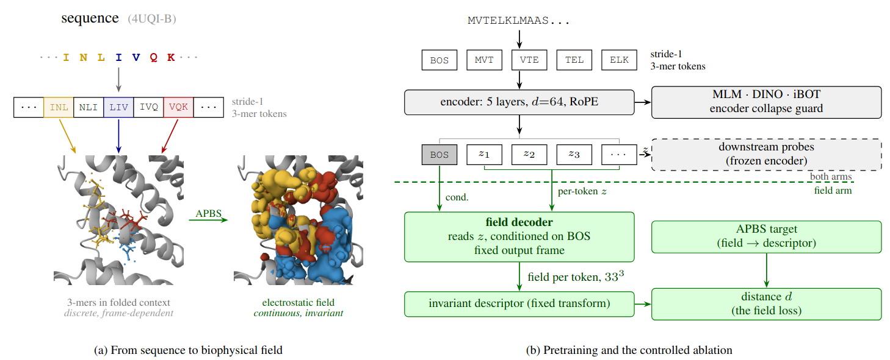
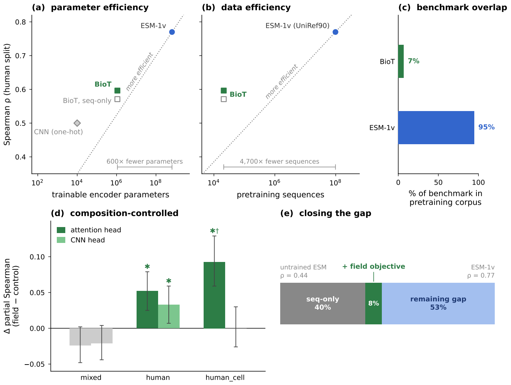

# Beyond Sequence and Structure: Pretraining PLMs on Continuous Biophysical Fields

<p align="center">
  
</p>

Most protein language models learn from sequence alone. Structure-aware models
add discrete atomic coordinates. We ask: what if the pretraining target were a
continuous physical field — the electrostatic environment each residue
creates?

The Biophysical Transformer (BioT) is a small RoPE transformer encoder
(5 layers, d = 64, ~679K encoder parameters) pretrained on stride-1 3-mer
tokens drawn from CATH structures. Each token carries its local electrostatic
potential — a 33³ voxel grid computed by APBS from the deposited structure —
and a rotationally invariant spherical-harmonic descriptor turns this into a
frame-free loss: a correct field shape scores well in any orientation, while
a featureless sphere scores worst. The field objective trains jointly with
masked language modelling, DINO and iBOT.

On FLIP Meltome thermostability, this closes 8 % of the gap between an
untrained 650M-parameter ESM encoder and ESM-1v on the human split — with
600× fewer parameters and 4,700× fewer pretraining sequences. A matched
one-flag control (--no-voxel) that is bit-identical at initialisation
isolates the contribution: the field arm’s advantage survives residualising
400-dimensional dipeptide composition and removing the 7 % of test proteins
that overlap the pretraining corpus.

> **Built with** Python 3.10 · PyTorch 2.6 · CUDA 12.6 · PyTorch Lightning 2.5 · [se3cnn](https://github.com/patjiang/se3cnn-patch)

---

## Setup

<details>
<summary><b>Automatic (recommended)</b></summary>

```bash
bash setup.sh
conda activate EBPT
pip install -e .
python test.py
```

`setup.sh` creates a conda environment called **EBPT** (Python 3.10), installs
PyTorch with CUDA 12.6, the [se3cnn fork](https://github.com/patjiang/se3cnn-patch)
for equivariant 3D convolutions, and all remaining dependencies. It skips
creation if the environment already exists, and runs a quick SE3 convolution
smoke test at the end.

`pip install -e .` makes `src/` importable so the scripts in `tests/` can find
the model code.

`test.py` is the full integration check: encoder, interaction block, voxel
decoder, and Lightning module forward pass. If it passes, you're ready.

</details>

<details>
<summary><b>Manual (step by step)</b></summary>

**1. Create the environment**

```bash
conda create -n EBPT python=3.10
conda activate EBPT
```

**2. Install PyTorch (CUDA 12.6)**

```bash
pip install --upgrade pip
pip install torch==2.6.0 torchvision==0.21.0 torchaudio==2.6.0 \
    --index-url https://download.pytorch.org/whl/cu126
```

**3. Install the SE3-CNN fork**

> [!NOTE]
> This fork includes a fix for `scipy.linalg.eigh` calls in `SO3.py`.

```bash
git clone https://github.com/patjiang/se3cnn-patch.git
cd se3cnn-patch
python setup.py install
cd ..
```

**4. Install helper libraries**

```bash
pip install appdirs lie_learn scipy torchinfo tensorboard scikit-learn pandas
```

**5. Install training dependencies**

```bash
pip install \
    pytorch-lightning==2.5.2 \
    pot==0.9.5 \
    einops==0.8.1 \
    matplotlib==3.10.3
```

**6. Verify SE3-CNN**

```python
import torch
from se3cnn.image.convolution import SE3Convolution

size = 32
scalar_field = torch.randn(1, 1, size, size, size)
conv = SE3Convolution(Rs_in=[(1, 0)], Rs_out=[(1, 1)], size=5)
vector_field = conv(scalar_field)
print("SE3-CNN OK")
```

**7. Install the package and run the test suite**

```bash
pip install -e .
python test.py
```

</details>

---

## What can be reproduced out of the box

**Everything downstream of FLIP Meltome.** FLIP is a public benchmark, and the
released checkpoints are all you need. That covers the main transfer table, the
composition-controlled analysis, the pretraining-exposure audit, and the
restricted re-run.

**The pretraining corpus is not yet public.** The electrostatic volume dataset
(~21k proteins, 33³ potential boxes) will be released separately. Due to the
large size of the dataset, it's difficult to find a good hosting solution.

---

## Repository layout

<details>
<summary><b>File tree</b></summary>

```
setup.sh               environment setup (conda + dependencies)
test.py                integration smoke test
pyproject.toml         package config for pip install -e .

checkpoints/           pretrained weights (included in the repo)
  BioT_voxel_s0.safetensors    field arm, epoch 75
  BioT_novox_s0.safetensors    control arm, epoch 79

src/                   model and training code
  model.py               LightningModule (networks, staging, optimisation)
  loss.py                reconstruction and distillation losses
  invariant_loss.py      spherical-harmonic descriptor and invariant terms
  blocks.py              encoder, decoder, collapse guard
  data.py                dataset and collation
  span_masking.py        residue-anchored span masking
  train.py               training entry point and ablation harness
  eval_utils.py          checkpoint loading, tokenisation, embedding

tests/                 evaluation and analysis scripts
  flip_meltome.py        embed → fit probes → postmortem
  stack_check.py         arm deltas, bootstrap CIs, composition control
  overlap_audit.py       pretraining-exposure audit
  organism_table.py      per-organism labels for stratified tests
  make_figures.py        all figures from cached results
  run_rerun.sh           drives the full and overlap-removed re-run
```

</details>

---

## Reproducing the Meltome results

Both checkpoints ship with the repo in `checkpoints/`. You need both -- the
claim is a *difference* between arms, so the control is not optional.

| | path | epoch |
|---|---|---|
| field arm | `checkpoints/BioT_voxel_s0.safetensors` | 75 |
| control arm | `checkpoints/BioT_novox_s0.safetensors` | 79 |

Each arm is evaluated at its own best validation epoch.

<details>
<summary><b>Step 1 — Embed and fit probes</b></summary>

```bash
python tests/flip_meltome.py embed --help
python tests/flip_meltome.py run   --help
```

`embed` turns a checkpoint into a per-split embedding cache. `run` fits the
probe heads and writes `test_predictions.csv`. Run both for each arm and split.

Name the output directories like this (the downstream scripts discover them
by name):

```
res_{novox,voxel}_{human,human_cell,mixed_split}_{e79,e75}
mt_{novox,voxel}_{human,human_cell,mixed_split}_{e79,e75}
```

</details>

<details>
<summary><b>Step 2 — Arm deltas and composition control</b></summary>

```bash
python tests/stack_check.py --arm attn \
    --run novox res_novox_human_e79 mt_novox_human_e79 \
    --run voxel res_voxel_human_e75 mt_voxel_human_e75 \
    --n-boot 4000 --split-name human --json human_attn.json
```

This backs the main transfer table and the composition-controlled table.

</details>

<details>
<summary><b>Step 3 — Pretraining-exposure audit</b></summary>

```bash
python tests/overlap_audit.py \
    --flip <FLIP_DIR> --train-dir <CORPUS>/train --val-dir <CORPUS>/val \
    --call 0.80 --null-reps 5 --out overlap_audit
```

Writes `candidates.csv` (the overlap call per test protein) and the JSON the
figures use. The `0.80` threshold comes from the shuffled null.

> **Note:** this step reads the corpus and can't run until the data is
> released. The `overlap_audit/` directory ships pre-computed so everything
> downstream works without it.

</details>

<details>
<summary><b>Step 4 — Restricted re-run (overlap removal)</b></summary>

```bash
bash tests/run_rerun.sh --dry     # check paths, discover arms, run nothing
bash tests/run_rerun.sh           # the real thing
```

Always `--dry` first -- it verifies all twelve directories exist and discovers
which probe heads the predictions tables actually have.

</details>

<details>
<summary><b>Step 5 — Species stratification</b></summary>

```bash
python tests/organism_table.py \
    --res-dir res_voxel_mixed_split_e75 \
    --emb-dir mt_voxel_mixed_split_e75 \
    --uniprot overlap_audit/uniprot.json \
    --out organisms.csv
```

Prints a ready `stack_check --restrict-to` command for each organism group
large enough to carry an interval (≥200 proteins). Compare each group against
the full mixed-split value, not against other groups.

</details>

<details>
<summary><b>Step 6 — Figures</b></summary>

```bash
python tests/make_figures.py --audit overlap_audit --rerun rerun
```

</details>

<br>


<p align="center">  
</p> 

<p align="center"> <em> <b>(a–b)</b>&ensp;BioT reaches ρ&nbsp;=&nbsp;0.60 on FLIP Meltome (human split) with 600× fewer parameters and 4,700× fewer pretraining sequences than ESM-1v. <b>(c)</b>&ensp;Only 7% of test proteins overlap BioT's pretraining corpus, versus ~95% for ESM. <b>(d)</b>&ensp;The field-minus-control Δ survives full dipeptide composition control on the human and human_cell splits (* = 95% CI excludes zero). <b>(e)</b>&ensp;The field objective adds 8% of the untrained-to-ESM-1v gap; 53% remains. </em> </p>

---

<details>
<summary><b>A few things to know</b></summary>

- **Batch size is 1.** The voxel tensor's first dimension is the residue
  count, not the protein count.
- **`masked_seqs` and `labels` arrive without BOS.** `preprocess_sequence`
  adds it inside the training step. Code that feeds the encoder directly
  needs to prepend BOS itself, or every position shifts by one silently.
- **Labels are `-100` at unmasked positions** (including padding) and the
  original token at masked positions.
- **Embedding caches must carry a `sequence` field.** `stack_check` refuses
  a cache without one, because joining on row index risks silent misalignment.

</details>

---

## Not in this repository (yet)

The pretraining corpus and the analyses that depend on it. Both land together.
Until then, the appendices on field reconstruction, the descriptor breakdown,
and the frame assumption are not independently checkable.

---

## Citation

```bibtex
@inproceedings{<KEY>,
  title     = {Beyond Sequence and Structure: Pretraining PLMs on Continuous Biophysical Fields},
  author    = {<AUTHORS>},
  booktitle = {<VENUE>},
  year      = {<YEAR>}
}
```

## License

MIT. See [LICENSE](LICENSE).
